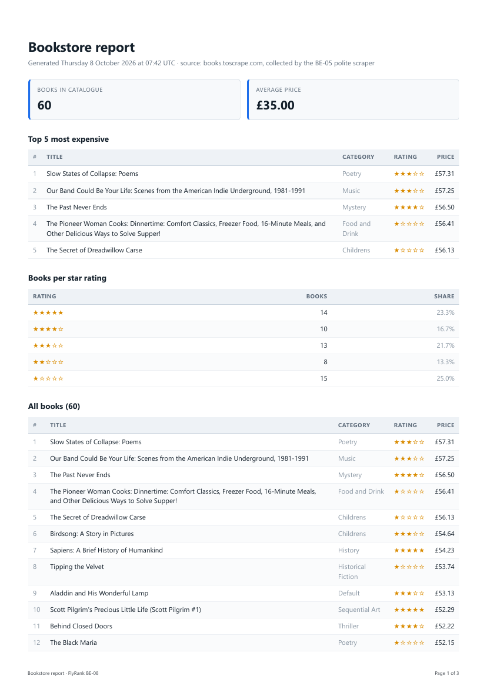
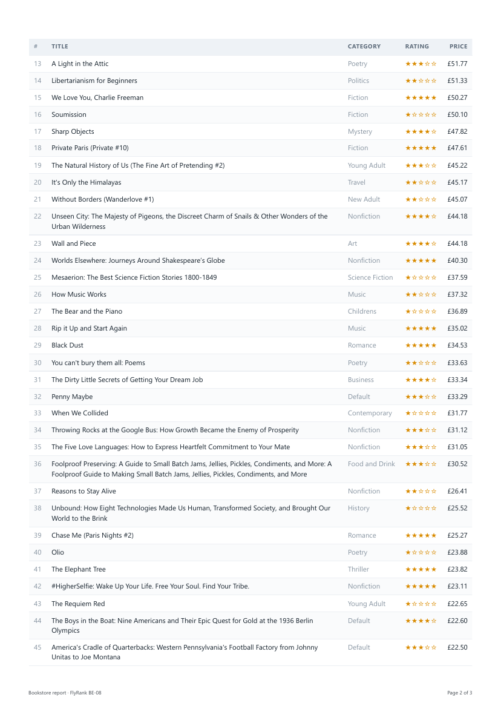

# PDF report generator — FlyRank BE-08 (A8)

Query a SQLite database with SQL, render the result into a real PDF through a
headless browser, and hand the file out by link. The JSON responses carry the
report's **address**; only the download endpoint carries its bytes.

> **Deviation from the brief, declared up front.** The assignment offers a
> JavaScript lane (Express + `node:sqlite`) and a Python lane (FastAPI +
> `sqlite3`). This is built in **ASP.NET Core (.NET 9)** instead, to stay
> consistent with BE-01…BE-07 in the same track. Everything the stages teach is
> unchanged: SQLite is still the database (`Microsoft.Data.Sqlite`), and the PDF
> is still produced by **Playwright** driving headless Chromium
> (`Microsoft.Playwright` — the official .NET binding of the same engine, with
> the same `LaunchAsync` / `SetContentAsync` / `PdfAsync` calls). Every
> requirement in section 6 of the brief is behavioural, and each one is met.

---

## The dataset

**Option B — the bookstore.** The 60 validated book records collected by my
BE-05 *polite scraper* from `books.toscrape.com`, reused here as
`seed-data/books.json`. Real data I gathered myself, not invented rows.

Each record contributes four fields: `title`, `price_gbp`, `rating`, `product_url`
(plus `category`, which the report shows for context).

---

## Run it

Requires the .NET 9 SDK. From `PdfReportGenerator/`:

```bash
dotnet build
dotnet run -- install-browser     # downloads Chromium for Playwright, once
dotnet run -- seed                # fills report.db from seed-data/books.json
dotnet run                        # API on http://localhost:5080
```

`install-browser` exists because the documented route,
`pwsh bin/Debug/net9.0/playwright.ps1 install`, needs PowerShell 7. The
sub-command calls the same CLI directly out of the package, so Windows
PowerShell 5.1 is enough.

Two more sub-commands exist purely as the brief's stage checkpoints:

```bash
dotnet run -- report-json         # Stage 2: prints the report object as JSON
dotnet run -- render-test         # Stage 3: writes reports/test.pdf
```

### Safe to run twice

`dotnet run -- seed` deletes every row before inserting, inside one
transaction. Running it twice leaves exactly 60 books, not 120 — and if an
insert failed halfway, the delete rolls back with it, so the database is never
left empty by a crashed seed.

---

## The API

| Method | Route | Answers with |
|---|---|---|
| `GET` | `/health` | `{ "status": "ok" }` |
| `POST` | `/reports` | `201` + `{ id, createdAt, file }` — or `200` with the existing report if one was already made today |
| `GET` | `/reports` | every report, newest first *(extra, not required)* |
| `GET` | `/reports/{id}` | the record; unknown id → `404` |
| `GET` | `/reports/{id}/file` | the PDF itself, `application/pdf` |

`POST /reports` accepts an optional body. `{"force": true}` skips the
once-per-day check and generates a fresh report.

---

## The aggregation SQL

Four queries collapse 60 rows into the numbers people actually read. They live
in `Data/ReportQueries.cs`.

```sql
-- 1. How many books are we reporting on?
SELECT COUNT(*) FROM books;

-- 2. What does a book cost on average?
SELECT AVG(price) FROM books;

-- 3. The top 5 most expensive. A ranking, not an aggregate:
--    no GROUP BY, because no rows are being collapsed.
SELECT id, title, price, rating, category, url
FROM books
ORDER BY price DESC
LIMIT 5;

-- 4. Books per star rating. The real GROUP BY: one output row per
--    distinct rating, COUNT(*) computed inside each bucket.
SELECT rating, COUNT(*) AS count
FROM books
GROUP BY rating
ORDER BY rating DESC;
```

And the long table at the bottom of the document — every book, on purpose,
because a one-page PDF never shows you the page-break bug:

```sql
SELECT id, title, price, rating, category, url
FROM books
ORDER BY price DESC, title ASC;
```

---

## The page-break trap

The long table crosses a page boundary, and by default Chromium slices a row
in half across it and drops the column headers on page 2. Three rules in the
print stylesheet (`Reporting/HtmlTemplate.cs`) fix it:

```css
table { break-inside: auto; }   /* a TABLE may split across pages - fine */
tr    { break-inside: avoid; }  /* a ROW may not - it moves whole instead */
thead { display: table-header-group; }  /* repeat headers on every page   */
h2    { break-after: avoid; }   /* no heading stranded at a page bottom   */
```

`print-color-adjust: exact` is also set, because browsers strip background
colours when printing unless told not to — without it the striped table prints
flat white.

This works because the renderer *is* Chrome's own print engine. Playwright
loads the HTML into a real headless Chromium and calls its Print-to-PDF; it is
not a PDF library guessing at layout, which is why ordinary CSS controls it.

---

## Stage 4 — at what point would I move this work out of the request?

The moment a second person can click the button at the same time, or the
moment the dataset stops being 60 rows. Generating this report blocks the
request for about **7 seconds**, and a web server answers requests from a
fixed pool of threads — so N concurrent reports means N threads doing nothing
but waiting on Chromium, and every other caller queues behind them. The user
is held hostage too: they cannot close the tab, and a dropped connection or a
proxy timeout destroys work that was nearly finished. I would move generation
out of the request as soon as either the row count or the concurrent-user
count stops being 1 — `POST /reports` answers `202 Accepted` with an id
immediately, a background worker runs query → render → save, and
`GET /reports/{id}` reports `pending` until it flips to `done`. That is the
BE-06 pattern, and this assignment is a deliberate demonstration of the
problem it solves.

## Stage 5 — ask twice, get one

`POST /reports` first checks whether a report already exists for today. If one
does, it returns that report's id and link with **200** instead of generating
a second one and answering 201. `{"force": true}` skips the check.

**What the check protects against:** a user double-clicking "Generate report",
a browser retrying a request it thinks timed out, or a client library with
automatic retries — all of which send the same intent twice and must produce
one effect, not two. Without it you pay twice for the work and end up with two
files that are byte-for-byte pointless duplicates.

**Where a missing check costs real money:** a payment endpoint. A customer
double-clicks "Pay now", the request is charged twice, and you refund it,
apologise, and absorb the processing fee — or, with no idempotency key in the
whole chain, you do not notice until the chargeback arrives. The same rule
protects "send the invoice email": the workshop's *never email a customer
twice* is this check with a worse failure mode, because an email cannot be
deleted after it lands.

---

## Proof

### The whole ride, by hand

```bash
dotnet run -- seed         # Seeded 60 books. Table now holds 60 rows.
dotnet run -- seed         # Seeded 60 books. Table now holds 60 rows.   <- still 60
dotnet run                 # http://localhost:5080
```

```bash
$ time curl -i -X POST http://localhost:5080/reports
HTTP/1.1 201 Created
Location: /reports/1
Content-Type: application/json

{"id":1,"createdAt":"2026-10-11T07:42:33.39Z","file":"/reports/1/file"}

real    0m7.09s          <- the pipeline ran inside the request
```

```bash
$ curl -o my-report.pdf http://localhost:5080/reports/1/file
$ file my-report.pdf
my-report.pdf: PDF document, version 1.4, 3 page(s)
```

### The double-click proof

Two plain `POST /reports` back to back, on a day that already has a report:

```bash
$ curl -s -X POST http://localhost:5080/reports   # {"id":1,...}  200 OK
$ curl -s -X POST http://localhost:5080/reports   # {"id":1,...}  200 OK
$ ls reports/*.pdf | wc -l                        # unchanged
```

Same id in both answers, **no new file**, and the second request returns in
milliseconds because no pipeline ran. With `{"force": true}` the same endpoint
returns `201` and a new id.

### Automated checkpoint

`verify-reports.ps1` builds the project, starts the API on port 5080, asserts
every checkpoint in the brief, and shuts the API down again:

```powershell
.\verify-reports.ps1
# ...
# 29 passed, 0 failed
```

It covers: health; `201` + id + link + `Location` + exactly one new file +
a measurably blocking request; `GET /reports/{id}` and `404` for an unknown id;
the download served as `application/pdf` with a real `%PDF` header; two repeat
POSTs returning the same id with no new file; `force` producing a new id and a
new file; and malformed JSON returning `400` without writing anything.

### Page 1 of a generated report



And page 2, which is where the page-break work shows: page 1 ends on row 12,
page 2 begins on row 13 — no row is sliced — and the column headers are
repeated at the top.



### A note on the data

Book #45, *The Torch Is Passed*, carries the category `"Add a comment"`. That is
a real artifact of the BE-05 scraper, which picked up a page element instead of
the breadcrumb on that one record. It is left in rather than quietly patched:
the report is supposed to show what is in the database, and silently cleaning
one row to make a demo look tidier is how reports start lying.

---

## What I would fix next

- **The wait is still inside the request.** `POST /reports` blocks for seconds.
  The BE-06 pattern (Hangfire job + `202 Accepted` + a status endpoint) is the
  real fix and is listed in the brief as a stretch.
- **A browser is launched per report.** Roughly 1.5s of the wait is Chromium
  starting up. Pooling one browser would remove that, but the rendering itself
  still blocks the request, so pooling treats the symptom.
- **The idempotency gate is per-process.** A `SemaphoreSlim` makes the
  check-then-write atomic inside one instance. Two instances behind a load
  balancer would both pass the check. The durable fix is a `UNIQUE` index on
  the report's date, with the loser of the race catching the constraint
  violation and reading the winner's row.
- **Reports are never cleaned up.** `reports/` grows forever. A scheduled job
  deleting files older than N days is the obvious next piece.

---

## Project layout

```
PdfReportGenerator/
  Program.cs                    minimal API + the CLI sub-commands
  Data/
    Paths.cs                    every file path, in one place
    Db.cs                       connection + schema
    Seeder.cs                   books.json -> report.db, safe to run twice
    ReportQueries.cs            Stage 2: the aggregation SQL
    ReportsRepository.cs        the reports table (bookkeeping, not bytes)
  Models/ReportData.cs          what the SQL produces and the template consumes
  Reporting/
    HtmlTemplate.cs             Stage 3a: numbers -> HTML (+ the print CSS)
    PdfRenderer.cs              Stage 3b: HTML -> PDF via Playwright
    ReportService.cs            the pipeline + the once-per-day rule
  seed-data/books.json          input data from BE-05 (committed)
  report.db                     generated, gitignored
  reports/                      generated artifacts, gitignored
```
